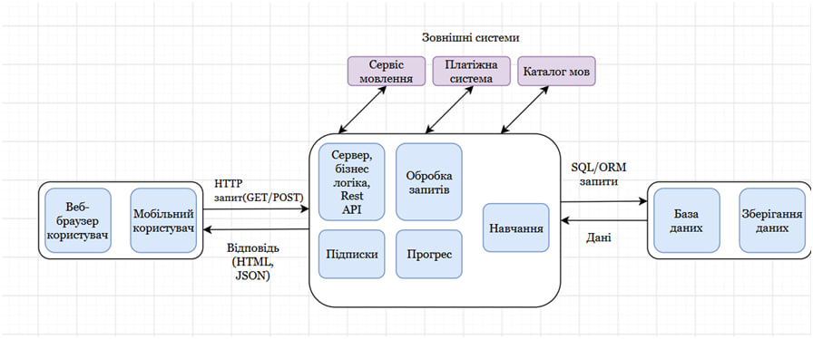
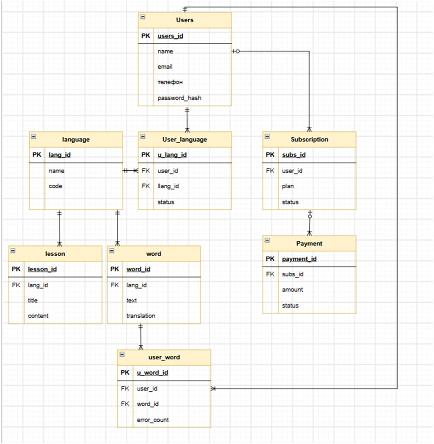
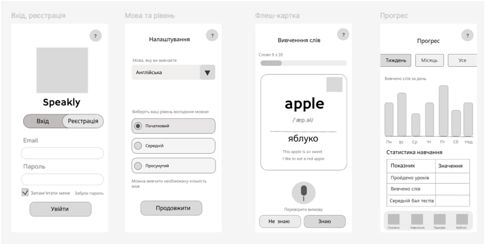
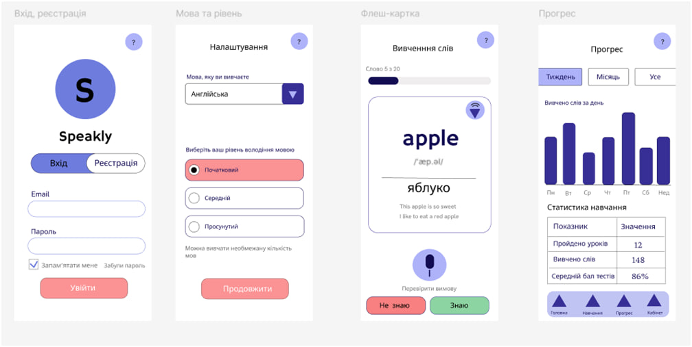

# Лабораторна робота №3. Проєктування застосунку Speakly

### Архітектурний стиль та архітектурна діаграма

Для Speakly обрано клієнт-серверну архітектуру з єдиним серверним застосунком, який надає REST API. Клієнти (веб-браузер і мобільний застосунок) надсилають HTTP-запити (GET/POST) і отримують відповіді у форматі HTML або JSON. Серверна частина містить бізнес-логіку та модулі обробки запитів, навчання, підписок і прогресу, а дані зберігаються в базі даних, до якої сервер звертається через SQL/ORM-запити. Окремо показано зовнішні системи: сервіс мовлення, платіжну систему та каталог мов.

### ER-діаграма

На діаграмі зображено модель даних застосунку. Центральною сутністю є Users, яка пов'язана з мовами через проміжну таблицю User_language, зі словами через user_word (із лічильником помилок error_count) та з підписками Subscription. Сутності lesson і word належать певній мові (language), а підписка має зв'язані платежі в таблиці Payment. Усі зв'язки типу «один до багатьох» реалізовано через зовнішні ключі (FK).

### Каркас (wireframe) UX/UI

Каркас містить чотири основні екрани мобільного застосунку: вхід і реєстрацію, вибір мови та рівня, флеш-картку для вивчення слів і екран прогресу. Він показує лише структуру та розташування елементів у сірих тонах, без кольорів і графіки. Для кожного екрана визначено основні елементи керування: поля форми, перемикачі рівня, кнопки «Знаю» та «Не знаю», вкладки періодів і нижню навігацію.

### Макет (mockup) UX/UI

Макет є візуально опрацьованою версією каркаса тих самих чотирьох екранів. Додано фірмову палітру в синьо-фіолетових тонах, акцентні рожеві та зелені кнопки, логотип, іконки та заповнені приклади даних: слово «apple» з транскрипцією, діаграму вивчених слів за тиждень і таблицю статистики навчання. Макет демонструє остаточний вигляд інтерфейсу, який буде реалізовано в застосунку.